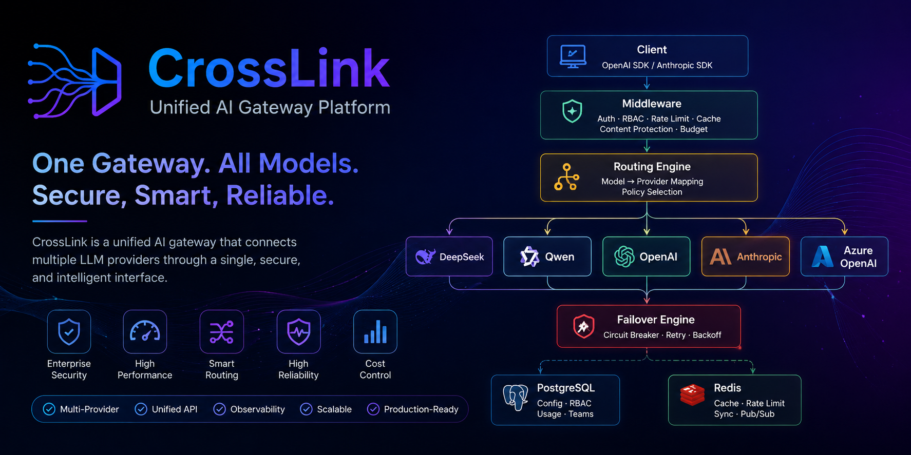
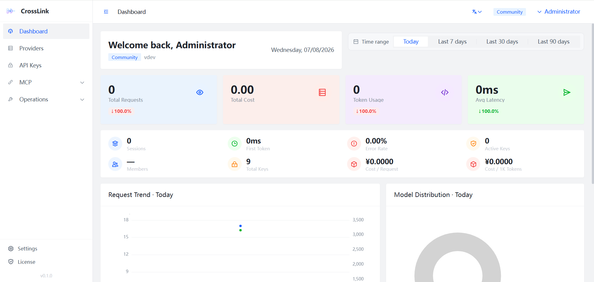
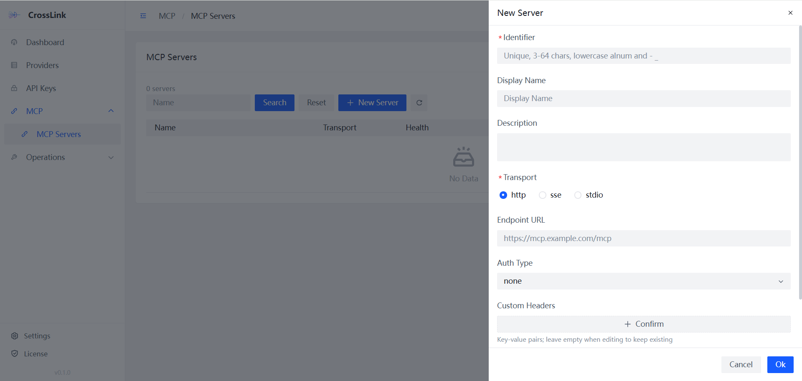
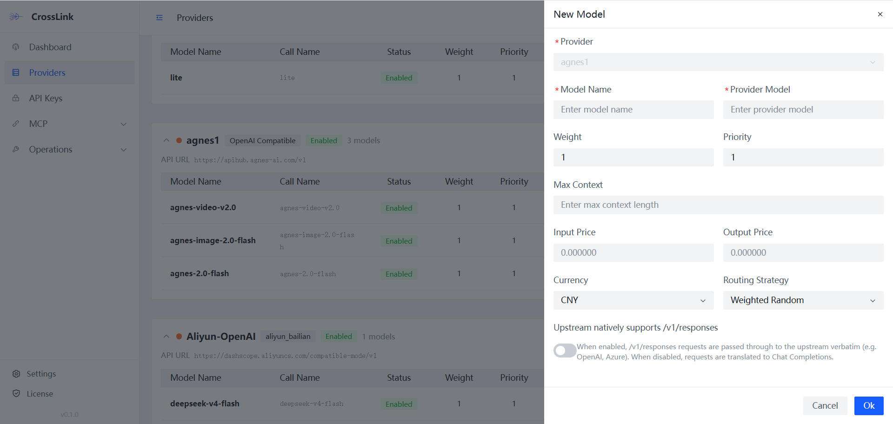
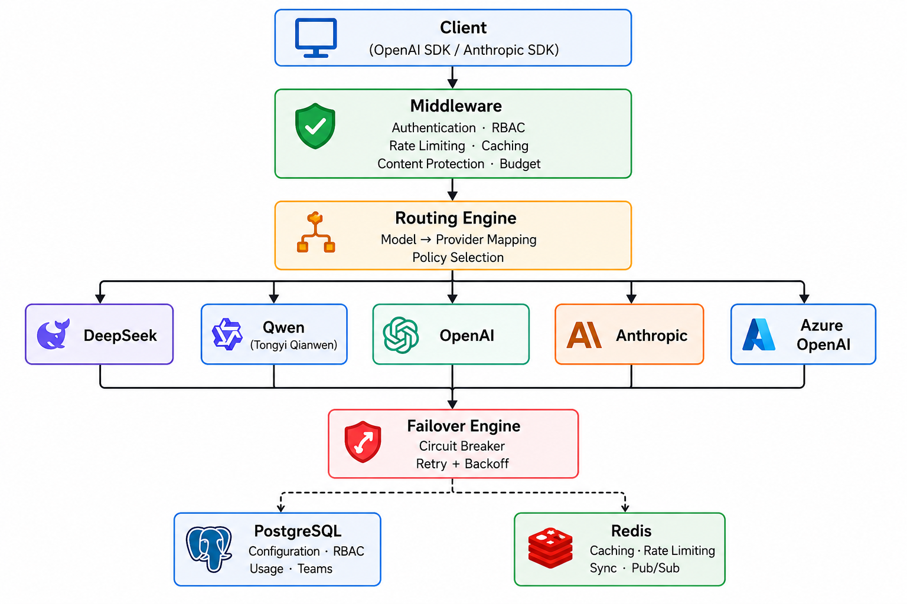

<div align="center">



<br/>


<br/>


<br/>
<br/>

# CrossLink

### One Gateway. Every Model. Zero Lock-in.

**OpenAI & Anthropic Compatible LLM API Gateway**

[English](README.md) | [中文](README_zh.md) | [العربية](README_ar.md)

A unified proxy with bidirectional protocol translation, error-classified
failover, an MCP gateway with per-tool RBAC, pluggable guardrails, and a built-in
admin dashboard, for OpenAI, Anthropic, Azure, DeepSeek, Qwen, Ollama, and any
OpenAI-compatible provider.

[Get Started](#quick-start) · [Highlights](#highlights) · [Architecture](#architecture) · [Docs](docs/README.md) · [Sponsor](#sponsors)

</div>

---

## Why CrossLink?

Every LLM provider has a different API format, auth mechanism, and feature set.
Adapting your code for each one is tedious, error-prone, and locks you in.

CrossLink is a **universal adapter** between your application and any LLM provider:

- **One endpoint**: Your code talks to a single API in either OpenAI or Anthropic format
- **Any provider**: Requests are routed to OpenAI, Anthropic, Azure, DeepSeek, Qwen,
  Ollama, or any OpenAI-compatible service
- **Bidirectional translation**: Full streaming SSE conversion between OpenAI,
  Anthropic, and the OpenAI Responses API, including tool use and extended thinking
- **Resilient by classification**: Failover isn't blind retry. Errors are classified as
  persistent (quota/billing — one strike, long cooldown) or transient (rate limit —
  threshold-based), so retries go where they can actually succeed
- **Observable routing**: Every response carries `x-crosslink-fallback-*` headers, and a
  routing-stats API shows configured-vs-actual traffic distribution so you can see drift

---

## Highlights

- **Bidirectional streaming translation** — OpenAI ↔ Anthropic ↔ Responses API, all three
  directions, via a real state machine (not request-level rewrites). Handles thinking blocks,
  partial-JSON tool args, and token counting mid-stream. → [Architecture](docs/architecture.md)
- **Error-classified failover** — DB-backed rule table distinguishes persistent vs.
  transient failures; half-open single-flight probing prevents stampedes when a flaky
  provider returns. → [Routing & Failover](docs/routing-and-failover.md)
- **MCP gateway with per-tool RBAC** — Not a thin proxy. Transport abstraction, tool
  discovery with singleflight caching, encrypted credentials, and allow/deny lists scoped
  by key, team, or role. → [MCP Gateway](docs/mcp-gateway.md)
- **Guardrails as a plugin registry** — Plug in any engine (regex, external API, future
  ML) via `RegisterEngine`. Actions: block / log / mask. Per-model config, fail-open or
  fail-closed. → [Architecture](docs/architecture.md)
- **Routing transparency** — `x-crosslink-fallback-model` / `x-crosslink-fallback-count`
  headers on every response, plus a routing-distribution API showing configured-vs-actual
  weight, deviation, error rate, and latency per provider.
- **Self-healing dispatch counters** — Per-(provider, model) concurrency/RPM limits via
  Redis Lua with a TTL heartbeat; a crashed process can't leave a provider stuck "busy".
- **GM national crypto + air-gapped ready** — SM2/SM3/SM4 mode (including HMAC-SM3 JWT
  signing) and a self-hosted slider CAPTCHA. No reCAPTCHA/hCaptcha dependency — deploys
  fully offline for 信创 compliance. → [Deployment](docs/deployment.md)

---

## Dashboard Preview

<p align="center">
  
</p>
<p align="center"><em>The admin dashboard: request volume, cost, token usage, latency, error rate, and model distribution at a glance.</em></p>

<p align="center">
  
</p>
<p align="center"><em>MCP server management: registry with transport types (HTTP/SSE/stdio), health status, and per-server configuration.</em></p>

<p align="center">
  
</p>
<p align="center"><em>Provider & model configuration: weight, priority, pricing, and routing strategy per model.</em></p>

---

## Quick Start

### Prerequisites

- Docker and Docker Compose, **or** Go 1.22+ to build from source
- PostgreSQL 14+ (or KingbaseES) and Redis 7+ when running outside Compose

> **Database support:** PostgreSQL 14+ and KingbaseES are first-class, fully
> migrated backends. MySQL and SQLite are **experimental** — their migration
> sets stop at the initial schema and are suitable for evaluation only.

### Docker Compose (Recommended)

Frontend ([CrossLink-UI-Standard](https://github.com/HotRiceNoodles/CrossLink-UI-Standard)) and backend are built together. One command starts everything:

```bash
git clone https://github.com/HotRiceNoodles/CrossLink.git
cd CrossLink
docker compose -f deployments/docker-compose.dev.yaml up --build
```

The dashboard and the API gateway share one entry point at `http://localhost`
(port 80) — all examples below use it as-is.

> **China network?** Use `docker compose -f deployments/docker-compose.cn.yaml up --build` with Go and npm mirrors pre-configured.

### Build from Source

```bash
git clone https://github.com/HotRiceNoodles/CrossLink.git
cd CrossLink
cp configs/config.example.yaml configs/config.yaml
# Edit config.yaml with your database and Redis settings
make build
./bin/crosslink
```

> Running from source, the gateway listens on `:8080` — swap
> `http://localhost:8080` into the examples below.

### Make Your First Request

Create an API key in the admin dashboard (`http://localhost`), then:

```bash
curl http://localhost/v1/chat/completions \
  -H "Authorization: Bearer cl-your-api-key" \
  -H "Content-Type: application/json" \
  -d '{
    "model": "deepseek-chat",
    "messages": [{"role": "user", "content": "Hello!"}]
  }'
```

> **No provider key yet?** Enable zero-cost demo mode (`demo.enabled: true` in
> `config.yaml`) — a mock provider plus an embedded demo key power a public `/demo` try
> page, so you can exercise the gateway without any upstream account.

**OpenAI SDK (Python)**

```python
from openai import OpenAI

client = OpenAI(
    base_url="http://localhost/v1",
    api_key="cl-your-api-key"
)

response = client.chat.completions.create(
    model="deepseek-chat",
    messages=[{"role": "user", "content": "Hello!"}]
)
print(response.choices[0].message.content)
```

**Anthropic SDK (Python)** — note the `deepseek-chat` model on the Anthropic endpoint:
that's CrossLink translating Anthropic → OpenAI → DeepSeek behind the scenes.

```python
import anthropic

client = anthropic.Anthropic(
    base_url="http://localhost",
    api_key="cl-your-api-key"
)

message = client.messages.create(
    model="deepseek-chat",
    max_tokens=1024,
    messages=[{"role": "user", "content": "Hello!"}]
)
print(message.content[0].text)
```

---

## Architecture

<p align="center">
  
</p>

```
Client → Auth/RBAC/RateLimit → Route Resolver → FallbackEngine → Provider Adapter → Upstream LLM
```

See [Architecture](docs/architecture.md) for the request flow, the streaming translator
state machine, the fallback engine's timeout budgeting, and the 5-phase graceful shutdown.

---

## Features

### Core Gateway

- **Dual Protocol**: `/v1/chat/completions` (OpenAI) and `/v1/messages` (Anthropic) with
  automatic bidirectional translation, streaming included
- **Multi-Provider**: OpenAI, Anthropic, Azure OpenAI, DeepSeek, Qwen, Moonshot, Ollama,
  and any OpenAI-compatible provider
- **Intelligent Routing**: 6 strategies: weighted random, round-robin, least latency,
  least cost, least busy, and canary deployment
- **Automatic Failover**: Multi-provider fallback chains with circuit breakers, configurable
  retry policies (exponential/fixed/linear backoff), and error classification
- **Response Caching**: Redis-based caching with per-model TTL, gzip compression, and
  cache key isolation per user
- **Video Generation**: `POST /v1/videos` with status polling and content download,
  routed through the same fallback chain as chat
- **Prompt Templates**: Curated template catalog managed at `/admin/api/templates`;
  key holders discover them via `GET /v1/templates` (metadata + ready-to-use curl examples)

### Security & Control

- **Rate Limiting**: Per-key RPM/TPM limits with global concurrency control (2000)
- **RBAC**: Role-based access control for providers, models, API keys, and MCP
- **Budget Enforcement**: Per-key and per-team budget limits enforced at the gateway with
  automatic circuit breaking (budget management console: Enterprise)
- **Guardrails**: Built-in engines (keyword filter, content length, credential-leak
  detection with an auto-seeded default rule) plus a pluggable `RegisterEngine` registry;
  block / log / mask actions, admin CRUD, per-model config
- **Scoped PATs**: Personal access tokens for CI / machine access with read-only usage,
  budget, and health APIs
- **SSRF Protection**: Dialer- and redirect-level guards on outbound provider calls
- **Crypto Flexibility**: Standard (SHA-256/RSA/AES) or Chinese national cryptography (SM3/SM2/SM4)

### Observability

- **Usage Analytics**: Token usage, cost tracking (including tiered image pricing and
  per-key price multipliers), latency metrics, cache hit rates, and fallback/retry counts
  per request
- **Prometheus Metrics**: Built-in metrics endpoint for monitoring
- **OpenTelemetry**: Distributed tracing support
- **Structured Logging**: JSON logging with request context
- **Bundled OpenAPI Spec**: `/openapi.json` served out of the box for Postman import and
  SDK codegen

### MCP Gateway

- **Model Context Protocol**: HTTP/SSE transport, tool discovery with caching, health checks
- **Permission Management**: Per-principal tool access control (allow/deny by key, team, or role)
- **Call Logging**: Comprehensive tool call logging with monthly partitioning and auto-cleanup

### Operations

- **Vue 3 Admin Dashboard**: Built-in web UI for providers, models, keys, usage, and MCP
  management ([CrossLink-UI-Standard](https://github.com/HotRiceNoodles/CrossLink-UI-Standard))
- **Admin Playground**: Test chat, streaming, image generation, TTS / transcription,
  video, and the Responses API from the dashboard, through the real fallback chain
- **Zero-Cost Demo Mode**: Optional mock provider + embedded demo key power a public
  `/demo` try page with no upstream spend
- **Multi-Instance**: Redis Pub/Sub for provider registry sync and distributed round-robin
- **Graceful Shutdown**: 5-phase drain: in-flight SSE streams → HTTP shutdown → worker flush →
  background goroutine cancellation → DB cleanup
- **One-Command Deploy**: Docker Compose spins up gateway, frontend, PostgreSQL, and Redis in one command

---

## API

The gateway exposes OpenAI-compatible (`/v1/chat/completions`, `/v1/models`) and
Anthropic-compatible (`/v1/messages`) endpoints, video generation at
`/v1/videos`, and the MCP gateway at `/mcp/:server`. A bundled, importable
OpenAPI spec is served at `/openapi.json` — import it into Postman or generate
an SDK from it. The full reference, including request/response shapes, error
codes, and the `x-crosslink-fallback-*` response headers, is in
[docs/api-reference.md](docs/api-reference.md).

---

## Configuration

All configuration lives in `configs/config.yaml` (see
[`configs/config.example.yaml`](configs/config.example.yaml) for every key).
Every value can be overridden with environment variables using the `CL_` prefix
(e.g., `CL_DATABASE_HOST`, `CL_REDIS_PORT`). The essentials:

```yaml
database:            # PostgreSQL / KingbaseES
  host: localhost
  port: 5432
  user: crosslink
  password: crosslink
  dbname: crosslink

redis:
  host: localhost
  port: 6379

admin:
  username: admin
  password: changeme
  jwt_secret: "change-me-to-a-random-secret"

crypto:
  mode: standard    # standard (SHA-256/RSA/AES) or gm (SM3/SM2/SM4)
```

Providers are seeded from `configs/providers.yaml` on first run:

```yaml
providers:
  - name: deepseek
    adapter_type: openai_compatible
    base_url: https://api.deepseek.com/v1
    api_key: ${DEEPSEEK_API_KEY}
    models:
      - name: deepseek-chat
        provider_model: deepseek-chat
```

---

## Deployment

```bash
docker compose -f deployments/docker-compose.prod.yaml up -d --build   # Production
docker compose -f deployments/docker-compose.cn.yaml up --build        # China network (Go/npm mirrors)
```

Also included: production-ready Nginx config (TLS, security headers, SSE streaming)
at `deployments/nginx/`, a Caddyfile for automatic HTTPS, a systemd unit, and a
dedicated GM (SM2/SM3/SM4) deployment with GmSSL/Nginx + TLCP at `deployments/gm/`.

→ See [Deployment](docs/deployment.md) for all options and multi-instance scaling notes.

---

## Documentation

- [Architecture](docs/architecture.md) — request flow, translator state machine, fallback engine
- [Routing & Failover](docs/routing-and-failover.md) — strategies, circuit breaker, error classification
- [MCP Gateway](docs/mcp-gateway.md) — transport, per-tool RBAC, encrypted credentials
- [API Reference](docs/api-reference.md) — full endpoint reference
- [Deployment](docs/deployment.md) — all deployment variants
- [Changelog](CHANGELOG.md) — release history

---

## Roadmap

CrossLink is under active development. Current focus:

- [x] Provider guardrails with health-aware routing
- [x] Routing-distribution observability (`/admin/api/routing/stats`)
- [x] Self-healing concurrency counters (TTL heartbeat)
- [x] OpenAI Responses API translation (stream + non-stream) — engine + playground in
  Community; the public `/v1/responses` route ships with commercial editions
- [x] Self-hosted slider CAPTCHA (air-gapped ready)
- [x] Community guardrail engines (keyword / length / credential detection) with admin CRUD
- [x] Built-in admin playground (chat, image, audio, video, Responses)
- [x] Zero-cost demo mode (mock provider + public `/demo` page)
- [x] Bundled OpenAPI spec at `/openapi.json`
- [ ] Provider guard alert rules (Enterprise) — in progress
- [ ] Expanded guardrail engine ecosystem (ML-based classifiers)
- [ ] Multi-team budgets and audit (Enterprise)

Have a request? Open a [Discussion](https://github.com/HotRiceNoodles/CrossLink/discussions) or a [feature request](https://github.com/HotRiceNoodles/CrossLink/issues/new/choose).

---

## Community & Support

- 💬 **Questions & ideas** — [GitHub Discussions](https://github.com/HotRiceNoodles/CrossLink/discussions)
- 🐛 **Bug reports** — [open an issue](https://github.com/HotRiceNoodles/CrossLink/issues/new/choose) (use the bug-report template)
- 🔒 **Security reports** — see [SECURITY.md](SECURITY.md) for private disclosure
- **Conduct** — see [CODE_OF_CONDUCT.md](CODE_OF_CONDUCT.md)
- ⭐ **Like the project?** Give it a star — it helps others find CrossLink.

---

## Sponsors

CrossLink is an independent, volunteer-built open-source project. Sponsorships
fund CI runner time, a public demo instance, documentation translations, and
security reviews.

<p align="center">
  <a href="https://github.com/sponsors/HotRiceNoodles">
    
  </a>
</p>

**Using CrossLink in production?** Your company logo can appear here, alongside
priority access to the maintainers. Reach out via
[Discussions](https://github.com/HotRiceNoodles/CrossLink/discussions) or sponsor
directly — every sponsor is listed in this section.

---

## Star History

<p align="center">
  <a href="https://star-history.com/#HotRiceNoodles/CrossLink&Date">
    <picture>
      <source media="(prefers-color-scheme: dark)" srcset="https://api.star-history.com/svg?repos=HotRiceNoodles/CrossLink&type=Date&color=orange" />
      
    </picture>
  </a>
</p>

---

## Contributing

We welcome contributions of all sizes — bug fixes, features, docs, or ideas.

1. Fork the repository
2. Create a feature branch (`git checkout -b feature/my-feature`)
3. Commit your changes (`git commit -m 'Add some feature'`)
4. Push to the branch (`git push origin feature/my-feature`)
5. Open a Pull Request

See [CONTRIBUTING.md](CONTRIBUTING.md) for detailed guidelines.

## Contributors

Thanks to everyone who has contributed to CrossLink!

<p align="center">
  <a href="https://github.com/HotRiceNoodles"></a>
  &nbsp;&nbsp;
  <a href="https://github.com/jinghunsanzu"></a>
  &nbsp;&nbsp;
  <a href="https://github.com/ahfkfdkhdkfka-afk"></a>
  &nbsp;&nbsp;
  <a href="https://github.com/OldHunter0"></a>
</p>

### Development

```bash
make build          # Build binary (bin/crosslink)
make run            # Run the server
make test           # Run all tests
make lint           # Run golangci-lint
make clean          # Remove build artifacts
```

---

## Security

See [SECURITY.md](SECURITY.md) for our security policy and vulnerability reporting instructions.

---

## License

[Apache License 2.0](LICENSE)
